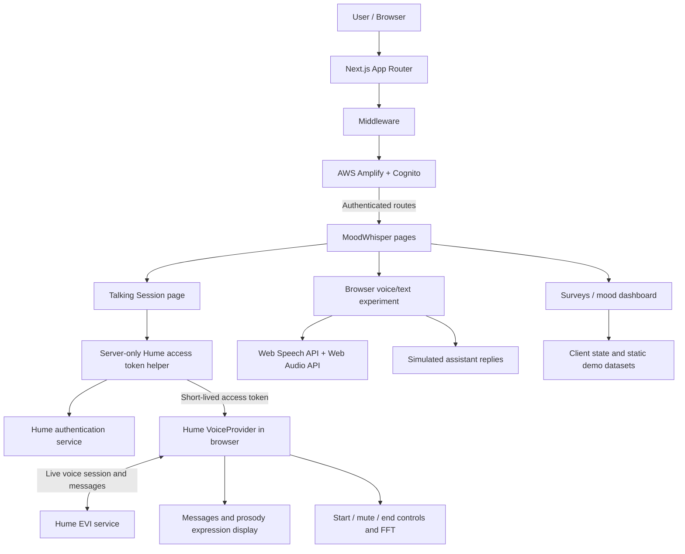

# Empathic Voice Interface — MoodWhisper Prototype

**Exploring emotion-aware voice interaction, conversational UI, and employee-wellbeing product experiences.**

[Repository](https://github.com/sinariazi/empathic-voice-interface-starter)

This repository extends the [Hume AI Empathic Voice Interface Next.js starter](https://github.com/humeai/hume-evi-next-js-starter) with an experimental **MoodWhisper** application. It combines a real-time voice interface with authentication, survey experiences, prototype mood dashboards, and exploratory mental-health chat UI.

**Project status:** experimental prototype / proof of concept. This is not a validated mental-health treatment product or a production-ready employee analytics platform. Some screens use static data or simulated responses; the integrations are not uniformly connected end to end.

## What it does

| Area | Current implementation |
| --- | --- |
| Empathic voice conversation | Hume EVI connection via `@humeai/voice-react`, with call start/end and mute controls |
| Conversation display | Displays user/assistant messages and available prosody expression scores |
| Audio visualization | Displays microphone FFT feedback during a Hume voice session |
| Authentication | AWS Cognito sign-up, confirmation, login, and authenticated-route middleware via Amplify |
| MoodWhisper UI | Landing, about, pricing, legal, survey, personal-dashboard, and admin screens |
| Mood tracking and surveys | Interactive questionnaire screens with charts and local component state |
| Alternative voice/text interface | Web Speech API recognition/synthesis experiment with example simulated assistant replies |

The project is best understood as an **applied-AI and human-computer interaction exploration** rather than a single fully integrated SaaS application.

## Technology

| Layer | Technology |
| --- | --- |
| Framework | Next.js 14 App Router, React 18 |
| Language | TypeScript |
| Real-time AI voice | Hume EVI and Hume React Voice SDK |
| Identity | AWS Cognito, AWS Amplify, Amplify Next.js adapter |
| Client audio experiment | Browser SpeechRecognition, SpeechSynthesis, Web Audio API |
| User interface | Tailwind CSS, Radix-based components, Framer Motion, Lucide |
| Visualizations | Recharts, microphone FFT and expression indicators |
| Data dependency | `@vercel/postgres` is declared; the inspected core voice flow does not require a database |
| Deployment target | Next.js-compatible hosting, such as Vercel |

## Architecture

The architecture has two distinct conversational experiments: a **Hume-powered voice session** and a **browser speech / simulated reply prototype**. They should not be confused.



### Hume conversation lifecycle

1. An authenticated user opens `/moodWhisper/talkingSession`.
2. The server-side `getHumeAccessToken()` helper requests an access token using `HUME_API_KEY` and `HUME_SECRET_KEY`.
3. The talking-session page passes that token to the client-only `Chat` component.
4. `VoiceProvider` manages the Hume connection and gives child components access to live session state.
5. The user starts a session and can mute, unmute, or end the call.
6. `Messages` displays conversational messages; `Expressions` renders the top prosody scores when present; `MicFFT` visualizes microphone activity.

**Architecture decision:** Hume API credentials are used in server-only code, while the browser receives an access token. The real-time provider integration is delegated to Hume's SDK rather than implementing a custom streaming protocol.

### Authentication path

- Amplify is configured with the Cognito user pool and app client IDs.
- Middleware uses the Amplify server adapter to check authenticated sessions before routes beginning with `/moodWhisper`.
- The authentication screens implement sign-up, sign-in, confirmation, and sign-out flows.

**Important implementation detail:** The current middleware's admin-route condition targets `/dashboard/admins`, while the repository includes `/admin`. Do not treat this as verified admin authorization for `/admin`. Route behavior and access control require review before public deployment.

### Alternative browser speech prototype

`components/mental-health-assistant.tsx` uses browser speech recognition, speech synthesis, microphone access, and a text/voice toggle. Its assistant responses are **hardcoded simulation strings**, not generated by Hume or another LLM. Speech recognition support is browser-dependent.

## Repository structure

```text
app/
  amplify-cognito-config.ts             # AWS Amplify browser configuration
  auth/                                  # Login, signup and confirmation pages
  moodWhisper/
    talkingSession/page.tsx              # Server-side Hume token retrieval
    callFunction/page.tsx                # Experimental browser speech UI
    personalDashboard/                   # Mood charts and tracker screens
    survey/                              # Survey interface
    landingPage/                         # Product landing page
  admin/                                 # Admin interface
components/
  Chat.tsx                               # Hume VoiceProvider setup
  Messages.tsx                           # Conversation transcript
  Expressions.tsx                        # Prosody-score indicators
  StartCall.tsx                          # Connect action
  Controls.tsx                           # Mute, end-call and FFT display
  MicFFT.tsx                             # Audio visualization
  mental-health-assistant.tsx            # Browser speech demonstration
  MoodDashboard.tsx                      # Chart-based example dashboard
  MoodTracker.tsx                        # Questionnaire UI
  employee-survey.tsx                    # Engagement survey prototype
  ui/                                    # Shared UI components
lib/
  cognitoActions.ts                      # Authentication actions
utils/
  getHumeAccessToken.ts                  # Server-only Hume token helper
  amplify-server-utils.ts                # Cognito session verification
middleware.ts                            # Authentication-based routing
.env.example                             # Configuration template
package.json
pnpm-lock.yaml
```

## Getting started

### Prerequisites

- Node.js **18.17+** (compatible with the declared Next.js 14 version; a supported Node.js LTS is recommended)
- pnpm (the repository includes `pnpm-lock.yaml`)
- Hume account, **API key** and **secret key**
- AWS Cognito user pool and user pool app client for authenticated MoodWhisper routes
- Microphone and browser permissions for audio features
- Network access to the respective external services

Some auxiliary routes may need additional database configuration. The repository has an environment template for PostgreSQL, but a complete, verified database initialization and migration workflow is not documented in the inspected source.

### 1. Clone and install

```bash
git clone https://github.com/sinariazi/empathic-voice-interface-starter.git
cd empathic-voice-interface-starter
corepack enable
pnpm install --frozen-lockfile
```

### 2. Configure credentials

Copy the supplied template:

```bash
cp .env.example .env.local
```

Set these values in **.env.local**:

```dotenv
HUME_API_KEY=your_hume_api_key
HUME_SECRET_KEY=your_hume_secret_key

NEXT_PUBLIC_USER_POOL_ID=your_cognito_user_pool_id
NEXT_PUBLIC_USER_POOL_CLIENT_ID=your_cognito_app_client_id
```

The existing `.env.example` also contains optional PostgreSQL placeholders. Populate those only if you are configuring code paths that need database access.

**Security:** Never commit `.env.local` or place `HUME_SECRET_KEY` in a `NEXT_PUBLIC_` environment variable. Cognito pool/client identifiers are intentionally client-visible; Hume service credentials must remain server-side.

### 3. Start the development server

```bash
pnpm dev
```

Open **http://localhost:3000**. This repository does not currently contain an `app/page.tsx` root route, so visiting `/` may return a 404. The MoodWhisper application is mounted under **/moodWhisper**, and unauthenticated requests there are redirected to **/auth/login** by middleware.

After setting up Cognito and authenticating, try:

- `/moodWhisper/talkingSession` — Hume-powered conversation
- `/moodWhisper/callFunction` — browser speech/text demo
- `/moodWhisper/personalDashboard` — example dashboard
- `/moodWhisper/personalDashboard/moodTracker` — questionnaire

### 4. Build for production

```bash
pnpm build
pnpm start
```

The package defines `pnpm lint` as `next lint`, which is the Next.js 14-era lint command. Builds and integrations have **not** been independently executed or verified as part of this documentation update.

## Important implementation details

### Emotion/prosody data

The real-time voice interface uses Hume's SDK message data, including available prosody scores, to display top-ranked expression indicators alongside the transcript. These scores are **model estimates**, not a clinical assessment or definitive measurement of someone's emotional state.

### MoodWhisper interface

The dashboard, surveys, admin UI, and other pages demonstrate proposed product interactions. For example, `MoodDashboard.tsx` uses explicit mock datasets, and `MoodTracker.tsx` stores answers in React state. They should not be presented as a persisted, production analytics pipeline.

### No custom emotion-model training

This repository integrates Hume's voice capabilities rather than training an emotion-recognition model from scratch. The main engineering focus is **integration, session handling, user experience, and prototype architecture**.

## Deployment

A Next.js deployment platform such as Vercel can host the application.

1. Import this repository into your hosting platform.
2. Configure `HUME_API_KEY`, `HUME_SECRET_KEY`, and the relevant Cognito environment variables.
3. Configure AWS Cognito app-client authentication settings and allowed URLs for the deployment environment.
4. Deploy the Next.js application.
5. Test login, the protected talking-session route, microphone permissions, Hume connection, and disconnect behavior.

Do not assume a successful build means the entire prototype is safe for public users. Review route protection, privacy, and the experimental wellbeing features before deploying.

## Engineering trade-offs and limitations

- **Upstream starter:** Hume's official EVI Next.js example provided the voice-integration foundation. This repository builds additional MoodWhisper experiments around that starter.
- **Prototype maturity:** Several views are exploratory and not wired to persistent backend services.
- **Simulated text assistant:** The browser speech/chat experiment uses hardcoded replies; it is not an operational AI mental-health assistant.
- **Authentication and authorization:** Middleware route coverage and admin access need correction and security tests.
- **Sensitive audio and wellbeing information:** Live audio and messages may be processed by external providers. Privacy, retention, consent, and regulatory obligations must be assessed before use with real people.
- **No clinical validation:** Emotion predictions should not be interpreted as mental-health diagnoses. The application must not be positioned as therapeutic or emergency support.
- **Browser compatibility:** Web Speech API features vary by browser; microphones require user permission and a secure context in production.
- **Operational resilience:** The repository does not establish production monitoring, systematic retry strategies, end-to-end tests, or a verified deployment pipeline.
- **Dependency age:** This implementation uses older declared SDK/framework versions. Compatibility and security need review before redeployment.

### Potential next improvements

These are **proposals, not implemented features**:

1. Separate the core Hume voice proof of concept from the broader MoodWhisper prototype into clearly bounded modules.
2. Correct the root navigation, authentication redirects, and admin authorization checks.
3. Add tests for credential failure, connection state, microphone permissions, and session interruption.
4. Replace simulated replies only where a real, safely designed AI workflow is justified.
5. Define consent and retention policies and minimize handling of potentially sensitive wellbeing/audio data.
6. Connect dashboards to validated data sources if analytics becomes a product requirement.
7. Add a deployment health check, CI, and supported dependency upgrade path.

## Project context and attribution

This is a technical exploration of **real-time AI voice integration, emotion-aware UX, and interactive wellbeing interfaces**. It illustrates experience with third-party AI services, frontend architecture, authentication, and product prototyping, while clearly separating functioning SDK integrations from illustrative UI.

The Hume EVI voice integration is based on the [Hume AI Next.js starter](https://github.com/humeai/hume-evi-next-js-starter). Please consult Hume's documentation and the upstream repository for API details and licensing.

Maintained in this repository by **[Sina Riazi](https://github.com/sinariazi)**.
